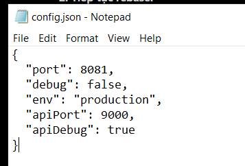
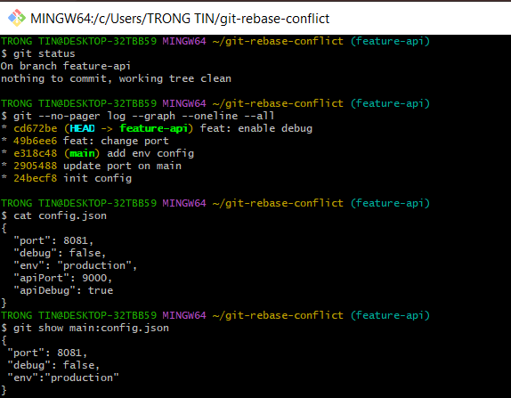

# Bài 3: Xử lý xung đột trong quá trình Rebase

## 1. Chuẩn bị
Tạo repository git-rebase-conflict với nhánh main.
Commit cấu hình ban đầu gồm port 8080 và debug false.

Tạo nhánh feature-api với hai commit:
- feat: change port: đổi port thành 9000.
- feat: enable debug: đổi debug thành true.

Trên main, tạo hai commit:
- update port on main: đổi port thành 8081.
- add env config: thêm env production.

## 2. Bắt đầu Rebase

```bash
git checkout feature-api
git rebase main
```

## 3. Xung đột lần 1
Git dừng khi áp dụng commit "feat: change port".
Hai nhánh sửa cùng trường port thành giá trị khác nhau.

Mở config.json và xử lý thủ công:
- Giữ port 8081, debug false và env production của main.
- Thêm apiPort 9000 để lưu cấu hình cổng API.
- Xóa toàn bộ dấu đánh dấu xung đột.

Sau đó chạy:

```bash
git add config.json
git rebase --continue
```


## 4. Xung đột lần 2
Git dừng khi áp dụng commit "feat: enable debug".
Commit này chỉnh sửa vùng cấu hình đã thay đổi ở bước trước.

Xử lý thủ công:
- Giữ các trường cấu hình production.
- Thêm apiDebug true để lưu tùy chọn debug riêng cho API.
- Xóa toàn bộ dấu đánh dấu xung đột.

Sau đó chạy:

```bash
git add config.json
git rebase --continue
```


## 5. Kết quả kiểm tra

```bash
git status
git log --graph --oneline --all
cat config.json
git show main:config.json
```

Dán kết quả thực tế tại đây.

Lịch sử thẳng, hai commit feature-api nằm sau commit mới nhất
của main. Không có merge commit. Rebase hoàn tất và thư mục
làm việc sạch. Nhánh main giữ nguyên cấu hình.



## 6. So sánh Merge và Rebase
Merge kết hợp lịch sử hai nhánh và có thể tạo merge commit.
Rebase áp dụng lại từng commit tính năng lên nền mới,
nên có thể phải giải quyết xung đột ở từng commit.
Các commit được áp dụng lại có mã hash mới.